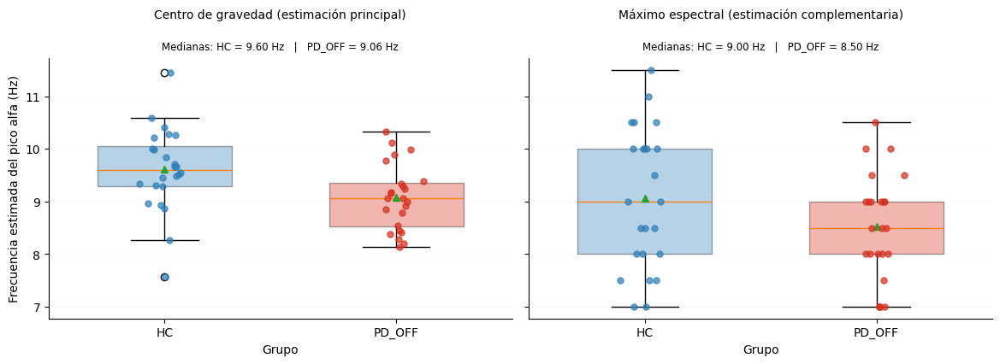
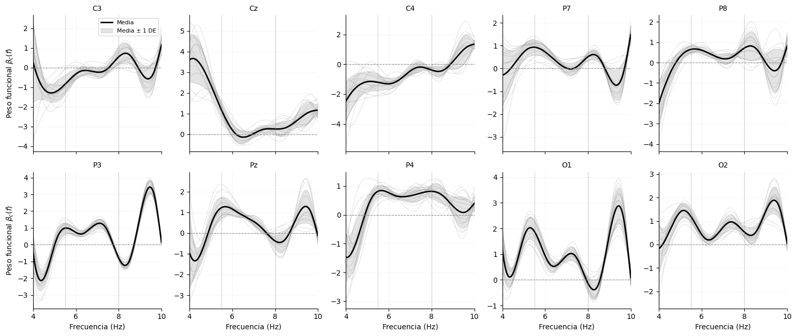

# Resultados

Cifras de la tesis transcritas de las salidas originales de los cuadernos ([`results/reported/`](../results/reported/)). Todas las métricas son **media ± DE sobre 15 evaluaciones externas** (5 pliegues × 3 semillas) a nivel de sujeto, con PD-OFF como clase positiva. Las DE no son intervalos de confianza, y las comparaciones entre configuraciones son descriptivas.

## 1. Mejor configuración por enfoque

Criterio: mayor exactitud balanceada; en caso de empate, mayor AUC.

| Enfoque | Representación | Modelo | BalAcc | AUC | Sensibilidad | Especificidad | F1 |
|---|---|---|---|---|---|---|---|
| Línea base escalar | escalares | Transformer | 0.732 ± 0.124 | 0.814 ± 0.106 | 0.797 ± 0.152 | 0.667 ± 0.215 | 0.746 ± 0.115 |
| A1 (sujeto) | Cholesky | LogReg | 0.818 ± 0.109 | 0.879 ± 0.097 | 0.840 ± 0.155 | 0.796 ± 0.149 | 0.816 ± 0.103 |
| B (theta + alfa) | Cholesky + FPCA | RandomForest | 0.781 ± 0.094 | 0.849 ± 0.128 | 0.877 ± 0.150 | 0.686 ± 0.141 | 0.794 ± 0.097 |
| A2 (época → sujeto) | Cholesky + FPCA | LogReg | 0.824 ± 0.115 | 0.902 ± 0.111 | 0.791 ± 0.167 | 0.856 ± 0.134 | 0.810 ± 0.114 |

El modelo propuesto en la tesis, **FDNN + A2 + Cholesky + FPCA**, obtuvo una exactitud balanceada de 0,781 ± 0,113 y un AUC de 0,875 ± 0,090. Fue la mejor arquitectura profunda en A2.

> Estas filas son los máximos de muchas configuraciones evaluadas sobre la misma validación cruzada. Por eso tienen un sesgo de selección optimista y no deben leerse como el desempeño esperado en una cohorte nueva.

## 2. Exactitud balanceada de cada modelo por enfoque

Mejor representación de cada modelo; la representación aparece entre paréntesis. La línea base escalar solo se evaluó con los modelos compatibles con vectores de características.

| Modelo | Línea base | A1 | B | A2 |
|---|---|---|---|---|
| LogReg | 0.684 (escalares) | 0.818 (Cholesky) | 0.778 (Cholesky + FPCA) | 0.824 (Cholesky + FPCA) |
| RandomForest | 0.715 (escalares) | 0.728 (Cholesky) | 0.781 (Cholesky + FPCA) | 0.734 (Cholesky) |
| MLP | 0.672 (escalares) | 0.752 (Cholesky) | 0.704 (Cholesky + FPCA) | 0.778 (Cholesky) |
| Transformer | 0.732 (escalares) | 0.718 (Cholesky + FPCA) | 0.752 (Cholesky + FPCA) | 0.740 (Cholesky) |
| CNN1D | — | 0.710 (Cholesky + FPCA) | 0.762 (Cholesky) | 0.707 (Cholesky + FPCA) |
| FNN | — | 0.672 (Cholesky + FPCA) | 0.624 (Cholesky) | 0.772 (Cholesky) |
| FDNN_Direct | — | 0.650 (B-spline) | 0.684 (Cholesky + FPCA) | 0.781 (Cholesky + FPCA) |
| AdaFNN | — | 0.609 (Cholesky + FPCA) | 0.694 (Cholesky) | 0.738 (Cholesky + FPCA) |
| EEGNet | — | 0.643 (Cholesky + FPCA) | 0.711 (Cholesky) | 0.752 (B-spline) |

En A1 y A2, ningún modelo profundo superó a la regresión logística. Con 48 sujetos, la frontera HC/PD-OFF en estas representaciones es aproximadamente lineal.

## 3. Aporte específico del ADF (cuaderno 04)

Las seis representaciones se evaluaron con el mismo clasificador (regresión logística) y las mismas 15 particiones.

| Representación | BalAcc | AUC | Sensibilidad | Especificidad |
|---|---|---|---|---|
| Escalar theta+alfa+PAF | 0.758 ± 0.143 | 0.845 ± 0.119 | 0.783 ± 0.192 | 0.733 ± 0.188 |
| PSD discreta 4-13 Hz | 0.818 ± 0.117 | 0.879 ± 0.124 | 0.840 ± 0.172 | 0.796 ± 0.149 |
| PSD discreta 4-13 Hz + PCA | 0.798 ± 0.126 | 0.848 ± 0.114 | 0.813 ± 0.192 | 0.782 ± 0.138 |
| A1 B-spline | 0.792 ± 0.114 | 0.806 ± 0.153 | 0.840 ± 0.155 | 0.744 ± 0.145 |
| A1 Cholesky | 0.818 ± 0.109 | 0.879 ± 0.097 | 0.840 ± 0.155 | 0.796 ± 0.149 |
| A1 Cholesky+FPCA | 0.803 ± 0.138 | 0.855 ± 0.116 | 0.827 ± 0.167 | 0.779 ± 0.167 |

La PSD discreta 4-13 Hz sin ADF alcanzó la misma exactitud balanceada media que A1 + Cholesky (0,818). El aporte del ADF no se manifiesta como mejora de exactitud, sino como:

- una representación de menor dimensión (110 frente a 190 variables);
- una geometría L² explícita;
- la posibilidad de interpretar el modelo sobre el dominio continuo de la frecuencia.

## 4. Caracterización de la cohorte (cuaderno 01)

La PAF posterior (O1, O2, Pz, P3, P4; centro de gravedad en 7-13 Hz) fue menor en PD-OFF (mediana 9,06 Hz) que en HC (mediana 9,60 Hz). La prueba de Mann-Whitney bilateral dio U = 418 y p = 0,0076, con rank-biserial = −0,451. La estimación por máximo espectral fue coherente en dirección, pero no significativa (p = 0,167).

## 5. Interpretabilidad funcional (cuaderno 05)

Las funciones de peso β_c(f) de la regresión logística sobre A1 + Cholesky se reconstruyeron en las 15 particiones. El logit funcional coincidió con el de scikit-learn, con un error máximo del orden de 10⁻¹⁴.

El patrón más estable aparece en pre-alfa (5,5-8 Hz): en los siete canales posteriores, la integral firmada fue positiva en las 15 particiones. Esto es coherente con el enlentecimiento espectral descrito en la literatura. Se trata de pesos condicionales de un modelo multivariado regularizado, no de efectos causales.

## 6. Verificaciones numéricas

| Verificación | Resultado |
|---|---|
| Cholesky, Enfoque A (11 × 11) | λ_mín = 7,72 × 10⁻⁴; cond(G) = 1,40 × 10³; error de distancia ≈ 10⁻¹⁵ |
| Cholesky, Enfoque B (4 × 4, por banda) | λ_mín = 6,09 × 10⁻⁵; cond(G) = 6,97 × 10³; error de distancia ≈ 10⁻¹⁵ |
| FPCA, Enfoque A | 5,13 componentes por canal en promedio; dimensión con relleno 58,7 (reducción de 46,7 % frente a 110) |
| Equivalencia del logit funcional | error máximo 3,1 × 10⁻¹⁴ |
